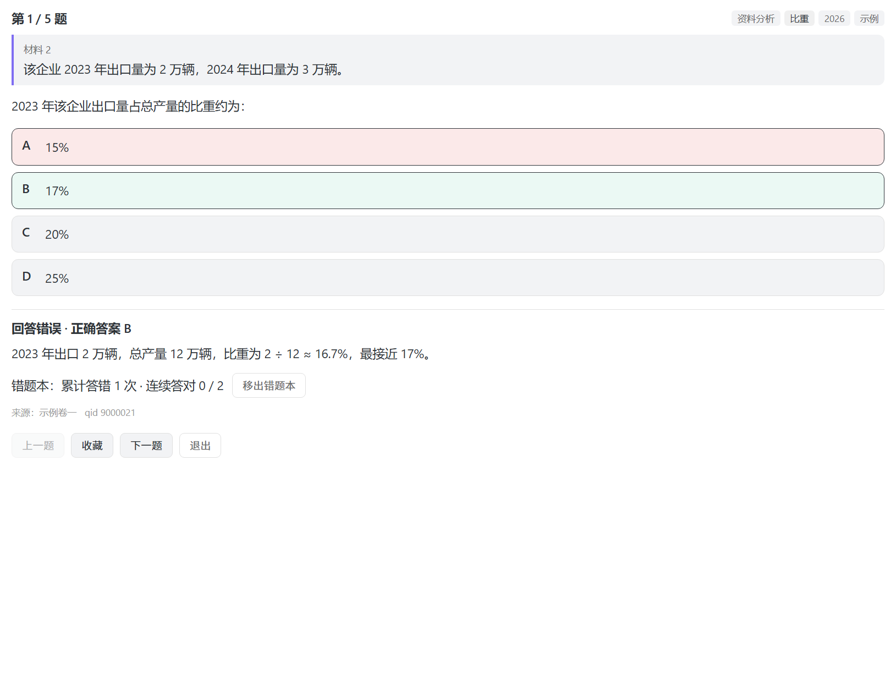

# 行测刷题 · Obsidian 插件

在 Obsidian 里直接刷行测真题：**随机抽题、考点专项、整卷模考、错题本**。
完全离线，不联网，不上传，没有广告、没有打卡、没有推送。

> ⚠️ **本仓库不含任何题目数据。**
> 这是一个纯工具，它只读取**你仓库里已有的真题笔记**。题目内容由你自己准备。

---

## 为什么又做一个刷题工具

市面上不缺刷题 App，缺的是**能跟你自己的笔记系统打通**的那个。

| | 常见刷题 App | 本插件 |
|---|---|---|
| 题目数据 | 平台闭源题库，导出受限 | 你自己的 Markdown 笔记，随时改 |
| 网络 | 强依赖，断网即瘫 | 完全离线 |
| 广告 / 推送 | 打卡、排名、续费提醒轰炸 | 无 |
| 笔记联动 | 错题只能存在 App 里 | 错题就在你的 Obsidian 库中 |
| 可信度 | 黑盒 | 开源可审计 |

如果你本来就用 Obsidian 整理行测笔记，那刷题这件事没必要跳出笔记软件。

---

## 界面

**随机刷题**：按模块 / 考点 / 年份 / 地区组合筛选后随机抽题，点选即判对错并展开官方解析。



**整卷模考**：按 515 套原卷整套作答，带搜索、倒计时与答题卡。


> 截图使用仓库自带的原创示例题生成，不含任何真题内容。

---

## 特性

- **随机抽题** — 按模块 / 考点 / 年份 / 地区任意组合筛选后随机抽取
- **考点专项** — 内置考点标签体系（片段阅读、逻辑填空、图形推理、比重、增长……），针对性突破
- **即时判分** — 点选即判对错，直接展开官方解析
- **整卷模考** — 按原整套卷作答，倒计时 + 答题卡 + 交卷评分
- **错题本 / 收藏** — 自动记录错题与错误次数，支持错题重刷；连续答对 2 次自动判定「已掌握」并移出（阈值可调，也可设成永不自动移出）
- **图片与公式** — 图形推理的图、资料分析的图表、官方解析里的公式，全部正常渲染
- **资料分析整组出题** — 一材多题按「材料 + 小题群」整体抽取，不会抽到缺材料的废题

---

## 安装

### 手动安装

1. 到 [Releases](../../releases) 下载 `main.js`、`manifest.json`、`styles.css`
2. 放到你的仓库目录：`<仓库>/.obsidian/plugins/obsidian-xingce/`
3. Obsidian 里：设置 → 第三方插件 → 关闭安全模式 → 刷新 → 启用「行测刷题」

### 从源码构建

```bash
git clone https://github.com/<你的账号>/obsidian-xingce.git
cd obsidian-xingce
npm install
npm run build     # 产出 main.js
```

开发模式（监听文件变化）：

```bash
npm run dev
```

---

## 数据从哪来

**这是使用本插件前唯一需要你解决的问题。**

插件本身不提供、不包含、不分发任何真题。你需要自己把真题整理成 Markdown 笔记放进仓库。可选的合法途径包括：

- 自己整理：从官方发布的考试公告、大纲与公开真题中录入
- 导出自有数据：从你已购买／已获得授权的题库产品中导出自己使用
- 使用公开领域材料：年代久远、权利已过期的试卷

整理好之后，在插件设置里把**「题库根目录」**指向那个文件夹即可。

如果你手上的题库是 **Excel / WPS 表格 / CSV / JSON**，不必手工改写成 Markdown——用自带的导入工具直接转换即可，见下一节。

---

## 导入你自己的题库

```bash
npm run import -- <你的题库.csv> --out <笔记输出目录>
```

也可以直接调用脚本：

```bash
node scripts/import.mjs 我的题库.csv --out 行测笔记 --source "自己整理"
```

### 支持格式

| 格式 | 说明 |
|------|------|
| `.csv` | 一行一题。Excel / WPS / Numbers 都可「另存为 CSV」，推荐 |
| `.json` | 题目数组，或 `{ "questions": [...] }` |

### 列名对照

唯一必需的是**题干**，其余缺失会自动留空。列名不区分大小写、空格与下划线：

| 用途 | 可用列名 |
|------|----------|
| 题干 | `题干` `题目` `问题` `内容` `stem` `question` `content` |
| 模块 | `模块` `科目` `题型模块` `module` `category` |
| 试卷 | `试卷` `卷名` `试卷名称` `exam` `paper` |
| 地区 | `地区` `省份` `region` `province` |
| 年份 | `年份` `年度` `year` |
| 考点 | `考点` `知识点` `标签` `分类` `point` `tag` |
| 题号 | `qid` `题目id` `编号` `id` |
| 材料 | `材料` `材料内容` `背景材料` `material`（资料分析用） |
| 选项 | `选项A`…`选项H`，或 `A`…`H`、`optionA`、`A选项`；也可合并成一列 `选项`，用 `\|` 分隔 |
| 答案 | `答案` `正确答案` `answer` |
| 解析 | `解析` `官方解析` `详解` `analysis` |

> `.xlsx` 请先在 Excel / WPS 里「另存为 CSV」。工具保持零运行时依赖，不引入表格解析库。

### 资料分析怎么处理

同一材料下的多道题，把「材料」列填成**完全相同的文本**，工具会自动归到同一个 `## 材料 N` 下，刷题时整组抽取——不会拆散共用材料的题组。

文本必须一字不差，多一个空格也会被当成不同材料。

### 图片

题干、选项、解析、材料里都可引用图片，两种写法都支持：

```markdown


```

导入时图片会复制到输出目录的 `90-图片/` 下，并自动改写成笔记内相对路径。网络图片（`http://` 开头）原样保留，不下载。

图片源目录默认取输入文件所在目录，也可显式指定：

```bash
node scripts/import.mjs 我的题库.csv --out 行测笔记 --images ./我的图片库
```

### 导入后会怎样

导入结束会自动用解析引擎**回读校验**，确认生成的笔记能被完整识别：

```
=== 导入统计 ===
生成笔记：2 篇
题目总数：6 题

各模块分布：
  数量关系             3 题
  资料分析             3 题

=== 回读校验 ===
✅ 解析引擎完整识别 6 题，与导入数一致
```

缺答案、缺选项或找不到图片的题目都会明确列出。

**正确答案的 `✅` 标记会依据「答案」列自动回填**，不需要手工标注。

---

## 笔记格式规范

插件按下面的格式解析笔记。只要符合这个结构，任意来源的笔记都能用。

```
---
类型: "真题"
试卷: "2026年安徽省公务员录用考试《行测》题"
地区: "安徽"
年份: "2026"
模块: "常识判断"
题数: "20"
---

# 2026年安徽省公务员录用考试《行测》题

## 第 1 题　<sub>qid 2262666 · 地理国情</sub>

下列关于四川省的相关说法中，不正确的是：

- **A**. 四川省是我国的资源大省、人口大省、经济大省
- **B**. 四川省地貌东西差异大……　✅
- **C**. 四川省是承接华南、华中……
- **D**. 四川省奋力推进的"两个跨越"是指……

**答案**：B

**官方解析**

本题考查地理国情常识。A项正确……B项错误……
本题为选非题，故正确答案为B。

---
```

要点：

- `frontmatter` 里提供 `试卷 / 地区 / 年份 / 模块`
- 题目标题写作 `## 第 N 题　<sub>qid 编号 · 考点</sub>`（分隔符是全角空格）
- 正确选项在行尾加 `✅`，同时用 `**答案**：X` 给出答案
- 解析以 `**官方解析**` 起头
- 题目之间用 `---` 分隔
- 图片用 `` 或标准 Markdown 图片语法均可

### 资料分析的特殊结构

资料分析是「一材多题」，用二级标题 `## 材料 N` 引出材料，其下用三级标题 `### 第 N 题`：

```
## 材料 1

<p>2013年，全国林产品出口644.55亿美元……</p>

### 第 1 题　<sub>qid 2263114 · 综合</sub>

2013年全国商品进出口总额约为多少亿美元？

- **A**. 1285
- **B**. 10891
- **C**. 25140
- **D**. 41553　✅

**答案**：D

**官方解析**
……
```

插件会把「材料 + 下属小题」当作一个抽题单元整体抽取，避免抽到没有材料的孤题。

---

## 使用

命令面板（`Ctrl/Cmd + P`）可用：

| 命令 | 说明 |
|---|---|
| 行测刷题：打开刷题面板 | 打开筛选与刷题界面 |
| 行测刷题：随机刷 10 题 | 按当前筛选条件直接开一组 |
| 行测刷题：随机刷 20 题 | 同上 |
| 行测刷题：打开整卷模考 | 选卷、计时、答题卡 |
| 行测刷题：重建题库索引 | 笔记有增删后重建索引 |

刷题面板左侧可切换**来源**：全部题库 / 我的错题 / 我的收藏。

### 错题本怎么算「已掌握」

一道题进入错题本后，**连续答对 2 次**会自动移出（答对一次不算——刚看过解析，可能只是记住了答案）。中间答错一次则连续计数清零，重新累计。阈值可在设置里改成 1 / 3 / 5 次，或设成「永不自动移出」只手动删。作答后反馈区会显示进度，例如「累计答错 3 次 · 连续答对 1 / 2」。

错题本按 **qid**（题目原始 id）去重，而不是按抽到的那一次：联考卷里同一道题会出现在多套卷里，错一次就记一条，不会重复堆积。

---

## 项目结构

```
src/
├── main.ts               插件入口，注册视图与命令
├── parser.ts             真题笔记 → 结构化题目（不依赖 Obsidian API）
├── bank.ts               索引构建、多维筛选、抽题单元、正文回填
├── store.ts              错题本 / 收藏 / 历史 持久化
├── render.ts             图片相对路径 → Obsidian 内嵌语法
├── settings.ts           设置面板
└── views/
    ├── practice-view.ts  刷题视图
    └── exam-view.ts      整卷模考视图
scripts/
├── import.mjs            通用题库导入（CSV / JSON → 真题笔记）
├── verify-parse.mjs      全量解析校验（覆盖率与数据质量报告）
├── test-bank.mjs         Bank 核心逻辑冒烟测试
├── test-ui.mjs           视图层冒烟测试（jsdom + API 桩）
├── shoot.mjs             真实浏览器（Electron）渲染并截图
└── analyze-qid.mjs       qid 重复情况分析
examples/
├── 示例题库/             原创示例笔记，clone 即可体验
└── import/example.csv    导入工具的列名模板
screenshots/              README 用图（由 shoot.mjs 生成）
```

`parser.ts` 刻意不依赖任何 Obsidian API，因此可以直接在 Node 端跑全量校验：

```bash
node scripts/verify-parse.mjs /path/to/你的真题笔记
```

---

## 测试

```bash
npm run test:all
```

分两层覆盖：

| 命令 | 范围 | 覆盖内容 |
|------|------|----------|
| `npm test` | 逻辑层 | 索引构建、多维筛选、抽题单元分组、正文回填、整套卷抽取 |
| `npm run test:ui` | 视图层 | 在 jsdom + API 桩上真实挂载视图，走完「抽题 → 点击选项 → 即时判分 → 错题本」 |
| `npm run shoot` | 视觉 | 用真实 Chromium 渲染界面并截图，确认 CSS 与布局正常 |

指定题库目录跑：

```bash
node scripts/test-bank.mjs /path/to/你的真题笔记
node scripts/test-ui.mjs  /path/to/你的真题笔记
node scripts/shoot.mjs    /path/to/你的真题笔记 ./screenshots
```

视图层测试会**真实执行 UI 代码路径**（DOM 渲染、事件回调、状态流转），用来抓出只有跑起来才会暴露的错误，而不只是验证数据。两层测试均已在 58890 题全量题库上验证通过。

---

## 关于题目版权

这个问题绕不过去，但也不该含糊地一律说"有风险"。实际情况是**分层的**。

### 真题本身：很可能不受著作权保护

《著作权法》第五条规定，"具有行政性质的文件"不适用著作权法。公务员考试属于国家管理事务，由人社部门组织实施，因此有观点认为**真题的题干与选项本身不构成受著作权法保护的作品**。新华网《公共试题能享有著作权吗?》一文即持此立场。

需要说明：这一点在司法实践中并非毫无争议，不同地区法院的认定可能存在差异。

### 官方解析：受保护，这是真正的高风险区

解析是培训机构教研团队原创撰写的内容，具有独创性，构成文字作品，受著作权法明确保护。**整批复制解析并公开分发，侵权风险很高。**

此外，题库的选取与编排构成汇编作品，图形图表等素材也可能单独受保护。

### 常见误解：不商业化就没问题

不成立。《著作权法》第二十四条列举的合理使用情形中，第一种是"为**个人**学习、研究或者欣赏，使用他人已经发表的作品"——限定在个人范围内。一旦通过网络向不特定公众提供，使公众可在其选定的时间地点获得，就脱离了这一前提。

漳州市芗城区人民法院在一起案件中处理过类似情形：某学校在其公众号推文中非商业性使用了他人美术作品，法院明确指出，该行为不属于合理使用，"无论其动机是否营利"，面向不特定社会公众的传播已落入信息网络传播权的控制范围。

也就是说：**是否营利影响赔偿数额，不影响侵权是否成立。**

当然，去掉商业化确实消除了两样重要的东西：

- **不正当竞争**——以存在竞争关系为前提，非商业使用通常不构成
- **按侵权获利计赔**——无获利时只能适用法定赔偿，数额通常显著更低

### 执法强度：粉笔是行业内最积极的

几个事实（截至 2026 年 10 月）：

- 2026 年 10 月 14 日，超格公考运营方北京宏毅格致教育科技有限公司就未经授权使用**粉笔自研模拟题**一事公开道歉，自愿赔偿 **450 万元**，并全平台下架、销毁侵权商品
- 同期，粉笔向上岸村优课教育等发出律师函，指控著作权侵权与不正当竞争
- 粉笔公开发布《关于粉笔模考试题及真题解析授权使用与侵权追责的严正声明》
- 据公开报道，粉笔会用 AI 将同行题目与自家题库快速比对，发现相似度即发起维权

需要注意的是，上述 450 万元案件针对的是**自研模拟题**（独创性明确），且粉笔对上岸村的诉讼**被法院驳回**。所以"抄了就必然赔钱"并不准确，但**维权行动本身是真实且高频的**。

### 一个可利用的安全港

粉笔在上述回应中公开承诺：

> 行业使用粉笔的解析和模拟题，只要**标明出处**且**题目数量不超过 100 道**，即可免费使用。

这意味着**小规模、注明出处的使用是得到官方许可的**。本仓库 `examples/` 下的原创示例题共 7 道，远低于该阈值，且内容为自行编写。

### 本项目的设计取舍

综合以上，本项目采取的策略是：

- 仓库只分发**代码**，不分发**内容**
- 所有题目数据留在**用户本地仓库**，由用户自行准备
- 插件只做读取、解析与呈现，不联网、不上传

这牺牲了开箱即用的体验，换来的是项目能长期、安全地活着 —— 尤其在你打算给它加商业化的时候。

如果你要公开分享自己整理的题库，请先确认你有权这样做，并标明出处。

*以上为公开信息整理，不构成法律意见。具体情况建议咨询专业人士。*

---

## 贡献

欢迎提 issue 和 PR。改动较大前建议先开 issue 讨论。

提交前请跑一遍：

```bash
npm run typecheck
node scripts/test-bank.mjs
```

---

## 许可

MIT，见 [LICENSE](LICENSE)。
